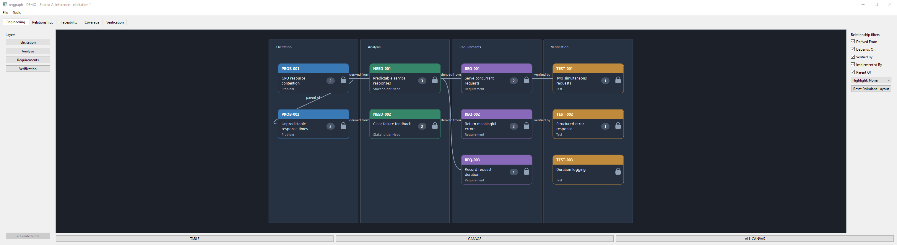
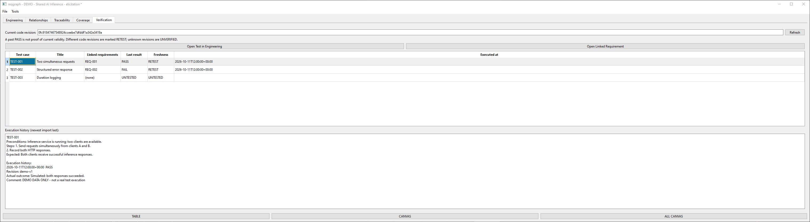

# reqgraph - Demo

A tool for structured requirements analysis.

The application is an experimental prototype intended to explore graph-based requirements engineering workflows.

## Features

- Structured requirements engineering - Organize stakeholder problems, needs, requirements, and verification artifacts into distinct engineering layers.

- Interactive visualization - Explore and edit engineering artifacts through a graph-based workspace, swimlanes, and tabular views.

- Relationship management - Define and validate dependencies, derivation relationships, and verification links between artifacts.

- End-to-end traceability - Trace requirements from stakeholder problems and needs to associated test cases, while identifying missing relationships.

- Verification management - Define test specifications, associate execution results with requirements, and track verification coverage.

- Pytest integration - Import automated test results and associate execution evidence with code revisions.

- Coverage analysis - Identify untested, failed, unverified, and potentially outdated verification evidence.

- Project persistence - Save and restore project data, relationships, and workspace layouts using SQLite.

